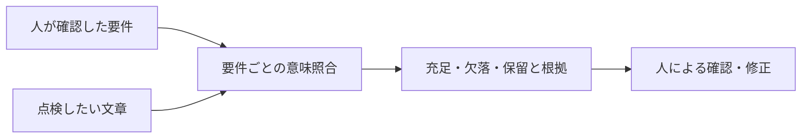

# UGH Audit Core

**日本語の案内文・回答文に、伝えるべき指示が書かれているかを点検するツールです。**
人が確認した要件と文章を照合し、要件ごとの根拠、欠落、矛盾、判定保留を返します。

[はじめて使う](docs/getting-started.md) · [API仕様](docs/server_api.md) ·
[検証と限界](docs/instruction_coverage_v4_validation.md) · [開発に参加する](CONTRIBUTING.md)

> **招待制ベータ / Python 3.10+ / MIT**
> HTTP・MCPで監査するには、利用者ごとの招待キーと本人のAnthropic APIキーが必要です。
> モデル料金は利用者負担です。一般向けの自動登録や、モデルAPIの無料利用枠はありません。

## どんな点検ができるか

たとえば、次の案内文を送る前に、指示の書き落としを点検します。

**文章：**「申請書は金曜日までに送付してください。」

| 伝えるべき要件 | 点検で区別したい内容 |
|---|---|
| 申請書を金曜日までに送付するよう伝える | 期限の指示が書かれている |
| 申請書の送付先が担当者であることを伝える | 送付先が書かれていない |

これは使い方の説明例で、実モデルの実行記録ではありません。
実行時はサービスが返す根拠と判定を確認します。



事実の正しさ、文章全体の品質、現実の業務が実行されたかは判定しません。
「氏名を公開しないよう伝える」という要件は、その禁止指示を文章に書く必要があります。
氏名が文章に出てこないだけでは、この要件を満たしたことにはなりません。

## 目的から選ぶ

| 目的 | 最初に読むもの | 必要なもの |
|---|---|---|
| 招待を受けてMCPで監査する | [利用開始ガイド](docs/getting-started.md) | 接続先・自分の招待キー・自分のAnthropicキー・秘密ヘッダー対応クライアント |
| 自分のサーバーで運営する | [招待制ベータの運用](docs/invite_beta.md) → [配備とバックアップ](docs/invite-beta-deployment.md) | Python環境、HTTPS、永続ストレージ、利用者への招待発行 |
| REST APIを組み込む | [API仕様](docs/server_api.md) | 利用者ごとの認証・BYOK設定と、判定保留を扱うクライアント |
| コードを読む・改善する | [開発参加ガイド](CONTRIBUTING.md) | Git、Python 3.10+、開発用仮想環境 |
| 評価結果や仕組みを調べる | [現行契約](docs/semantic_matching_v2.md) → [検証記録](docs/instruction_coverage_v4_validation.md) | 過去の診断値と現行の判定範囲の区別 |

## クイックスタート

1. [利用開始ガイド](docs/getting-started.md)で接続の前提を確認します。招待がない場合は、利用するサービスの運営者へ確認してください。
2. 招待キーと本人のAnthropicキーを、クライアントの秘密接続設定に登録します。
3. 文章と、人が確認した2〜5件の短い要件を用意し、MCPの `audit_answer` へ渡します。
4. 要件ごとの根拠・欠落・保留を読み、人が修正の要否を決めます。

[コピーできる合成データのリクエスト例と結果の読み方](docs/getting-started.md)を用意しています。
要件の自動生成は任意です。最初の利用では `auto_generate_meta=false` とし、明示要件を使います。

## 認証・料金・データ

| 設定 | 用途 |
|---|---|
| `Authorization: Bearer <招待キー>` | 利用者の識別、履歴の分離、サービス利用上限 |
| `X-UGH-Anthropic-Key` | 利用者自身のAnthropic APIキー（BYOK） |

HTTP監査は利用者のモデルキーがなければ拒否され、サーバー共通キーへ切り替わりません。
キーはチャット、ツール引数、監査本文、Gitへ入れず、秘密ヘッダーとして設定します。
MCPは `/mcp/`、REST監査は `/api/audit`。外部接続にはHTTPSを使います。

文章・要件とモデルキーは信頼する監査運営者を経由してAnthropicへ送られます。
確定した監査の本文・根拠は運営者のDBへ保存されます。[保存・削除方針の運用案](docs/data-policy.md)を確認してください。
運用窓口と開始条件が未確定の間は掲載・一般の招待開始を保留します。
モデルキーはアプリの監査履歴へ保存しません。クライアントやプロキシの秘密ヘッダーも保護してください。
回数制限は金額の上限ではありません。モデル提供者側の支出設定も確認してください。
詳細は [認証・履歴・利用上限](docs/invite_beta.md) にまとめています。

## 判定する対象

現在の契約は **schema 4.0.0 / `instruction_coverage_v2`** です。
要件の主体・対象・数量・日時・条件・義務・禁止を照合し、同義の言い換えも扱います。

| 要件ごとの結果 | 最終 `verdict` | 充足率 `C` |
|---|---|---|
| 1件以上あり、すべて `fulfilled` | `accept` | 1.0 |
| `unknown` はなく、`missing` がある | `rewrite` | fulfilled / 全要件数 |
| `unknown` がある、要件がない・不正、照合できない | `degraded` | null（不明） |

`missing` は欠落または明示矛盾、`unknown` は曖昧さやシステム障害などの判定保留です。
保留を0点と扱ったり、分母から除外して合格にしたりしません。
`requires_review` は欠落・保留・AI生成要件で true。AI草案の要件は `accept` でもレビューが必要です。
`is_reliable` は照合の確定を示し、事実の正しさや自動承認を保証しません。
上位 `S`・`delta_e`・`quality_score` は null、`metrics_scope="semantic_coverage_only"`。
フィールドの詳細は [現行契約](docs/semantic_matching_v2.md) を参照してください。

## 検証範囲とベータの状態

短い日本語の文章と、2〜5件の明示要件を使うパイロットが対象です。
schema 4の保存済み評価は合成20場面・80回答・280要件で、モデルによるラベル作成・レビューを含みます。
人による独立評価や、長文・他言語・実業務全般の精度保証を示すものではありません。
入力上限（16要件・回答32,000文字・1要件2,000文字）は、精度を検証した範囲とは異なります。

認証・BYOK・履歴分離・利用上限の実装と回帰テストはありますが、CI成功だけで本番の動作は保証できません。
Agensiでの当該スキル取得から実モデル監査までの確認は未完了で、掲載判断は保留です。
Agensiはスキルを配信し、監査サーバーをホスティングしません。
[公開前チェックと残件](docs/beta-release-checklist.md)、[掲載準備資料](marketplace/agensi/listing-draft.md)、
[検証記録・制約](docs/instruction_coverage_v4_validation.md)を確認してください。

## インストール

接続済みMCPを利用する人は、リポジトリのインストールは不要です。
コードを読む場合は次のコマンドで取得できます。これだけでは監査もモデルAPI呼び出しも実行しません。

```console
git clone https://github.com/Yuu6798/ugh-audit-core.git
cd ugh-audit-core
python -m venv .venv
```

仮想環境の有効化、依存の選択、ローカルテストは [CONTRIBUTING.md](CONTRIBUTING.md) を参照してください。
サーバー運営では `.[server]` と [招待台帳・永続DBの設定](docs/invite_beta.md) が必要です。
信頼されたローカルCLI・直接Python呼出は自分の `ANTHROPIC_API_KEY` を利用できますが、
公開HTTPのBYOK設定とは別です。インストールしただけでAPI認証や招待は設定されません。

## 実行経路と診断値

REST、ローカルMCP、Python `audit.audit()`、CLIは共有の `ugh_audit.pipeline.run_audit()` を使います。
必須の要件別意味照合を先に実行し、その結果から最終判定を決めます。
SBert・grv・旧検出器などは任意の診断で、最終判定を変更しません。
旧数値や旧判定は `legacy_metrics` に保持します。
内部実装と数値式は [現行契約](docs/semantic_matching_v2.md) と [旧診断の計算式](docs/formulas.md) を参照してください。

## schema 4.0.0 への移行

schema 3からの破壊的変更です。旧 `C`、上位 `S`・`delta_e`・`quality_score`、構造ゲートを
承認条件に使うクライアントは、要件別の根拠と現行 `C` を読むよう更新してください。
履歴も現在の根拠を再検証し、確認できない旧判定は `degraded` とします。
[移行契約](docs/semantic_matching_v2.md)と[API仕様](docs/server_api.md)に詳細があります。

## 旧数値の検証記録

2026年4月のHA48などの記録は、旧診断を対象とする保存資料です。
現行schema 4の精度や、単純なLLM監査への追加効果を保証するものではありません。
[旧評価と限界](docs/validation.md)、[版ごとの数値](docs/ha48_snapshot_versions.md)を参照してください。

## ディレクトリ構成

```text
ugh_audit/           REST・MCP、共有パイプライン、認証、保存、レポート
audit.py             Python API・CLI
detector.py          旧検出層
ugh_calculator.py    旧数値の計算
decider.py           旧判定層
cascade_matcher.py   SBertなどの回収補助
grv_calculator.py    grv診断
mode_signal.py       response_mode_signal
mode_grv.py          モード条件付きgrv診断
semantic_loss.py     意味損失の診断
batch_audit_102.py   既存データの一括監査
registry/ opcodes/   辞書・修復操作の定義
tests/              回帰・認証・利用者分離のテスト
docs/               利用手順・契約・設計・評価
examples/           開発用サンプル
analysis/ data/     保存された評価資料・分析
experiments/        研究用のLLMオーケストレーション
marketplace/agensi/  無料スキルの掲載準備・設定テンプレート
```

## Public API

監査はREST `POST /api/audit`、MCP `audit_answer`、Python `audit.audit()` を使います。
保存・レポート用には `AuditDB`、`GoldenStore`、`GoldenEntry`、
`generate_text_report`、`generate_csv` を `ugh_audit` からimportできます。
`AuditCollector` / `SessionCollector` は要件を受け取れず常に `degraded` となる非推奨APIです。
監査の新規組み込みには使用しないでください。

## MCP サーバー

Streamable HTTPで動作し、招待Bearerと `X-UGH-Anthropic-Key` の秘密ヘッダー設定が必要です。
監査サーバーのOAuthは未実装です。AgensiのOAuth認証だけではUGH側へ接続できません。
Swagger・OpenAPI・MCPの発見も招待認証が必要で、匿名の確認用は `/health` のみです。
[運営手順](docs/invite_beta.md)、[API仕様](docs/server_api.md)、[トラブルシューティング](docs/troubleshooting.md)を参照してください。

## 設計ドキュメント

### 利用・運営

| 読みたいこと | ドキュメント |
|---|---|
| 最初の監査・結果の読み方 | [利用開始ガイド](docs/getting-started.md) |
| 招待・BYOK・履歴分離・利用上限 | [招待制ベータ](docs/invite_beta.md) |
| 永続ボリューム・バックアップ付き配備 | [配備手順](docs/invite-beta-deployment.md) |
| 保存期間・削除依頼・停止中メンテナンス | [データ取扱い・削除方針](docs/data-policy.md) |
| 公開前の証拠・残件・実監査手順 | [公開前チェック](docs/beta-release-checklist.md) |
| REST・MCPの入力と出力 | [API仕様](docs/server_api.md) |
| 接続・インストールの問題 | [トラブルシューティング](docs/troubleshooting.md) |

### 判定契約・検証

| 読みたいこと | ドキュメント |
|---|---|
| schema 4の判定契約 | [要件別意味照合](docs/semantic_matching_v2.md) |
| 現行の検証・移行・保存証拠 | [schema 4の検証](docs/instruction_coverage_v4_validation.md) |
| AI生成要件の扱い | [メタデータパイプライン](docs/metadata_pipeline.md) |
| 旧HA48・HA20の結果と限界 | [旧評価記録](docs/validation.md) |
| 旧HA48の版と数値の対応 | [スナップショット履歴](docs/ha48_snapshot_versions.md) |
| 人手評価の手順 | [アノテーションプロトコル](docs/annotation_protocol.md) |

### 内部設計・研究資料

以下には旧診断や研究計画も含まれます。現在の公開判定の契約は上記のschema 4を参照してください。

| 読みたいこと | ドキュメント |
|---|---|
| 検出・回収・リファレンス検索 | [検出層](docs/detector_design.md)、[Cascade](docs/cascade_design.md)、[GoldenStore](docs/golden_store.md) |
| 旧数値式・閾値 | [計算式](docs/formulas.md)、[閾値索引](docs/thresholds.md) |
| 旧意味損失・grv | [L_sem](docs/semantic_loss.md)、[grv](docs/grv_design.md) |
| モード診断・advisory | [mode_affordance](docs/mode_affordance.md)、[補足](docs/mode_affordance_v1_addendum.md)、[Phase 8](docs/phase_e_verdict_integration.md) |
| 研究用オーケストレーション | [設計](docs/orchestration_design.md)、[Self-Audit実験](docs/self_audit_experiment.md) |
| 計画・関連プロジェクト | [ロードマップ](docs/roadmap.md)、[SVP/RPE](docs/svp_rpe_implementation_plan.md)、[修復opcode評価計画](docs/opcode_evaluation_plan.md) |

## 問い合わせ・開発参加

質問・再現可能な不具合・改善案は [GitHub Issues](https://github.com/Yuu6798/ugh-audit-core/issues) へ。
使用コミット、環境、秘密を除いた合成入力、期待した動作と実際の結果を添えてください。
APIキー、招待キー、実利用者の文章・履歴は公開しないでください。
個別の監査・削除依頼には[非公開窓口](docs/data-policy.md#削除依頼問い合わせ窓口)を使います。窓口確定までは一般の招待開始を保留します。
手順とPRの確認項目は [開発参加ガイド](CONTRIBUTING.md) にあります。

## 理論背景

背景研究として [UGHer](https://note.com/kamo6798/n/n5aeea478d12e)、
[RPE入門](https://note.com/kamo6798/n/n99cbb5307e13)、
[SVPとRPE](https://note.com/kamo6798/n/nb45c716a2c61)、
[ugh3-metrics-lib](https://github.com/Yuu6798/ugh3-metrics-lib) があります。
利用開始にこれらの理論を理解する必要はありません。

## License

[MIT License](LICENSE) © 2025 Yuu6798。
ソースのライセンスは、外部ホスティングやAnthropicのAPI利用枠を含みません。
